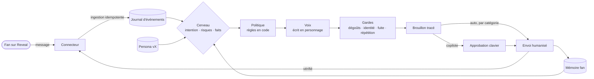
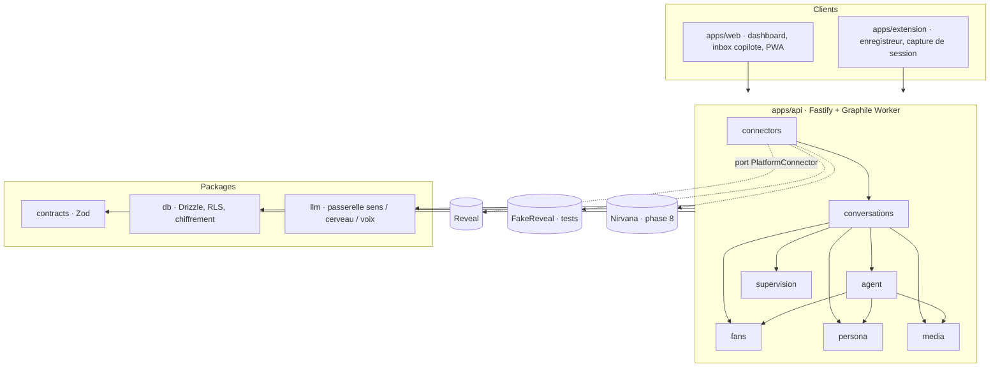

<p align="center">
  
</p>

<p align="center">
  
  
  
  
  
  
  
</p>

<p align="center">
  <b>Nirvana</b> est l'agent de chatting d'une créatrice de contenu.<br>
  Il lit les conversations, se souvient de chaque fan, répond avec sa voix à elle, et vend au bon moment.<br>
  Supervisé d'abord, autonome ensuite, et jamais prisonnier d'une plateforme.
</p>

<p align="center">
  <a href="#le-projet-en-une-minute">Le projet</a> ·
  <a href="#pourquoi">Pourquoi</a> ·
  <a href="#ce-quil-fait">Ce qu'il fait</a> ·
  <a href="#architecture">Architecture</a> ·
  <a href="#structure-du-dépôt">Structure</a> ·
  <a href="#comment-on-travaille-ici">Méthode</a> ·
  <a href="#sécurité">Sécurité</a> ·
  <a href="#feuille-de-route">Roadmap</a> ·
  <a href="#qui">Qui</a>
</p>

---

> **Session de code ?** Commence par [`CLAUDE.md`](CLAUDE.md), puis [`docs/00-START-HERE.md`](docs/00-START-HERE.md). Tout le reste en découle.

## Le projet en une minute

Une créatrice de contenu sur une plateforme privée (Reveal pour commencer) reçoit des dizaines de conversations par jour. Chaque fan attend une réponse personnelle, rapide, dans sa langue et dans *son* histoire avec elle. C'est ce qui fidélise, et c'est ce qui vend. Mais c'est un travail de tous les instants, impossible à tenir seule, et difficile à déléguer sans perdre la voix.

Nirvana prend ce travail en charge :

- il **lit** les conversations de la plateforme en temps quasi réel,
- il **comprend** chaque fan et s'en **souvient** (faits, préférences, historique, achats),
- il **répond** en incarnant la créatrice selon une persona versionnée, avec son style, ses limites et ses horaires de vie,
- il **propose** d'abord ses réponses à une personne qui approuve en une touche, puis **envoie seul** les catégories de messages où il a fait ses preuves,
- il **vend** des médias au bon moment, au bon prix, sans jamais revendre deux fois la même chose au même fan,
- il **trace** chaque décision pour qu'on puisse toujours répondre à « pourquoi a-t-il dit ça ? ».

Une seule créatrice aujourd'hui (Messalina), deux utilisateurs (elle et Charles). Mais le cœur est construit pour accueillir d'autres plateformes, et un jour la nôtre.

## Pourquoi

Les outils existants (OnlyChat et consorts) envoient directement sans supervision, gardent la mémoire du fan dans un champ texte, ne voient pas les médias, et épousent une seule plateforme. Nous voulions l'inverse :

| Eux | Nirvana |
|---|---|
| Envoi direct dès le premier jour | **Copilote** d'abord, autonomie progressive par catégorie |
| Notes libres sur le fan | **Mémoire structurée** et temporelle (faits datés, confiance, résumé) |
| L'IA ne voit pas les médias | Médias **compris** par un modèle de vision, vocabulaire structuré |
| Règles de vente dans le prompt | Règles **dans le code**, testées : prix, planchers, cooldowns, dégoûts, identité |
| Une plateforme | Un **cœur agnostique** et des connecteurs, dont notre future plateforme sans abonnement |
| Boîte noire | **Journal d'événements** complet, traces de chaque décision, évaluations avant chaque changement |

Et une exigence venue d'expériences précédentes (Imperium, OnlyScript) : **pas de spaghetti**. Une architecture modulaire aux frontières vérifiées par l'outillage, un dépôt propre en permanence, de la documentation qui dit où est la vérité.

## Ce qu'il fait



**Phase 0** (en cours) : fondations, zéro fonctionnalité visible. **Phases 1 à 2** : connecteur Reveal fiable, lecture et envoi manuel. **Phase 3** : le moteur IA en copilote. **Phase 4** : la supervision. **Phase 5** : autonomie progressive et application mobile pour la créatrice. **Phase 6** : le commerce (catalogue, offres, scripts). **Phase 7** : Instagram. **Phase 8** : notre propre plateforme. Détail : [`docs/roadmap.md`](docs/roadmap.md).

## Architecture

Un **monolithe modulaire** TypeScript. Chaque module métier a un domaine pur, des cas d'usage et une infrastructure, et n'expose que son `index.ts` ; ESLint refuse tout import qui traverse une frontière. Le cœur ne connaît aucune plateforme : Reveal est un adaptateur derrière un port, et notre future plateforme en sera un autre, sans réseau.



Les dix principes et leurs décisions (ADR) sont dans [`docs/architecture/overview.md`](docs/architecture/overview.md). Les quatre qui structurent tout :

1. **Journal d'événements** par conversation, append-only, source de vérité ; les tables d'état sont des projections.
2. **Un seul écrivain par conversation** : file série Graphile Worker sur Postgres, debounce par clé.
3. **Trois rôles LLM** (sens, cerveau, voix) derrière une passerelle unique, fournisseur changeable par rôle, sorties structurées validées.
4. **Les règles vivent dans le code**, pas dans les prompts : risques, prix, cooldowns, dégoûts, identité. Les prompts reçoivent des décisions.

## Structure du dépôt

```
Projet Nirvana/
├── README.md                 ce fichier
├── CLAUDE.md                 règles pour les sessions de code
├── Contexte et cahier des charges — Agent IA Reveal.md   la demande d'origine
├── brainstorm/               01 premier échange · 02 architecture et stack · 03 bilan · 04 revue des fondations
├── docker-compose.yml        Postgres 16 de dev (rôles créés par packages/db/docker/init.sql)
├── scripts/check-repo.mjs    vérifie les docs, les noms, les TODO, les commandes citées (dans pnpm check)
├── .scratch/                 brouillons, ignoré par git (un sous-dossier par fiche, inbox/ pour Charles)
├── apps/
│   ├── api/                  Fastify + Graphile Worker ; src/modules/<module>/{domain,application,infra,index.ts}
│   ├── web/                  Vite · React 19 · Tailwind v4 · shadcn/ui · PWA
│   └── extension/            Chrome MV3 (WXT) : enregistreur, capture de session
├── packages/
│   ├── contracts/            identifiants typés, argent, événements, jobs, persona, médias (Zod)
│   ├── db/                   schéma Drizzle, migrations, RLS, chiffrement
│   ├── design-system/        tokens Liquid Glass, pont Tailwind v4, classes nv-* (web + extension)
│   └── llm/                  LlmGateway, fournisseurs, prompts versionnés
├── personas/                 schéma + placeholder (la vraie persona est hors dépôt)
├── evals/                    scénarios Promptfoo : comportement, adversarial, régression
├── brand/                    logo, bannière, favicon (règles dans brand/README.md)
└── docs/
    ├── 00-START-HERE.md      quoi lire selon la tâche
    ├── architecture/         vue d'ensemble, modules, données, flux, connecteurs, IA, plateforme propre, menaces, ops
    ├── adr/                  14 décisions figées, 1 proposée
    ├── conventions/          code, API, tests, git, sécurité, hygiène
    ├── playbooks/            ajouter un module, un connecteur, un fournisseur ; persona ; évals
    ├── runbooks/             incident, secrets, restauration, session expirée
    ├── reference/            OnlyChat, projets antérieurs, vocabulaire média, schéma persona, API Reveal, fournisseurs
    ├── design/               brief et guide de l'interface (Liquid Glass)
    ├── sessions/             protocole, index LOG.md + journal par session (log/), fiches de tâches
    └── roadmap.md
```

## Comment on travaille ici

- **Une session = une fiche de tâche = une branche = une PR.** Les fiches ([`docs/sessions/tasks/`](docs/sessions/tasks/)) disent quoi lire, quoi faire, et comment on sait que c'est fini.
- **Les décisions sont des ADR.** On ne contredit pas une ADR acceptée ; on en écrit une nouvelle.
- **La doc est vraie.** Si le code et la doc divergent, la PR corrige la doc.
- **Le dépôt reste propre.** Temporaire dans `.scratch/`, nettoyage en fin de session, suppression encadrée par une procédure et une liste protégée ([`docs/conventions/hygiene.md`](docs/conventions/hygiene.md)).
- **Code en anglais, docs et interface en français.** Le [glossaire](docs/glossary.md) fait le pont.
- **`pnpm check` et `pnpm test` verts**, sinon ça ne part pas.

## Pile technique

| Couche | Choix | Pourquoi (en un mot) |
|---|---|---|
| Langage | TypeScript strict, Node 22, pnpm + Turborepo | un seul langage, types de bout en bout |
| API et jobs | Fastify 5 + Zod, Graphile Worker | simple, rapide, files série sur Postgres |
| Données | PostgreSQL 16 (Neon), Drizzle, RLS | SQL visible, isolation garantie par la base |
| IA | Vercel AI SDK derrière `LlmGateway` ; Grok 4.3 par défaut, Mistral et Venice en challengers, Gemini en repli pour l'analyse | fournisseur changeable par rôle |
| Front | Vite, React 19, TanStack, Tailwind v4, shadcn/ui, PWA | moderne, clavier d'abord |
| Extension | WXT (Manifest V3) | la seule façon propre de faire une extension en 2026 |
| Qualité | Vitest, Testcontainers, Playwright, Promptfoo, Langfuse | tests à chaque couche, évals avant chaque changement de modèle |
| Sécurité | Better Auth, Cloudflare Access, AES-256-GCM, gitleaks, lefthook | rien d'exposé, rien en clair, rien de commité |
| Hébergement | Hetzner + Coolify, sortie IP française | souverain, simple, peu cher |

## Sécurité

Les données sont intimes et les clés coûtent cher. Le projet part de ces hypothèses :

- Le dashboard n'est **jamais public** : accès par Cloudflare Access ou Tailscale, puis authentification et rôles.
- La **session plateforme** est chiffrée en base, jamais dans l'extension, jamais dans les logs ; rotation documentée.
- **Minimisation** : on ne garde que ce qui sert, avec des durées de rétention par défaut et une commande d'effacement par fan.
- Tout message de fan est **une donnée, jamais une instruction** : délimité, validé, gardé ; évals adversariales en CI.
- **Isolation par créatrice** garantie par la base (RLS), pas par la discipline.
- Chaîne d'approvisionnement verrouillée (lockfile figé, audit, versions épinglées), **gitleaks** avant chaque commit.
- Modèle de menaces, runbooks d'incident et de restauration, sauvegardes **testées** chaque trimestre.

Détail : [`docs/conventions/security.md`](docs/conventions/security.md), [`docs/architecture/threat-model.md`](docs/architecture/threat-model.md).

## Feuille de route

| Phase | Objectif | Fini quand |
|---|---|---|
| **0 · Fondations** | monorepo, contrats, base + RLS, serveur + worker, journal, port connecteur, CI | un message injecté produit un événement et un brouillon ; RLS prouvée par un test |
| **1 · Spike Reveal** | enregistreur d'API, analyse, FakeReveal | les 10 questions sur l'API ont une réponse |
| **2 · Connecteur** | lecture temps réel, envoi manuel vérifié, session chiffrée, kill switch | p95 détection < 60 s, envois vérifiés > 99,5 % |
| **3 · Moteur IA** | sens, cerveau, voix, politique, gardes, mémoire, évals | chaque message a un brouillon tracé ; évals vertes |
| **4 · Supervision** | inbox copilote clavier, prise en main, métriques | approuver un brouillon en < 5 s |
| **5 · Autonomie et mobile** | auto par catégorie, horaires, relances, PWA | notification de vente sur le téléphone de la créatrice |
| **6 · Commerce** | catalogue, offres, planchers, scripts, détection des ventes | aucun média revendu deux fois |
| **7 · Instagram** | veille, idées de reels, commentaires, publication | — |
| **8 · Plateforme propre** | notre site, connecteur in-process, paiements | — |

## Design

Les écrans n'existent pas encore, le design system oui : **Liquid Glass d'iOS 26 et 27 sur une nuit chaude, avec un seul accent néon rouge**. Surfaces translucides, flous, bords lumineux, animations à ressort, le tout sans jamais ralentir l'approbation au clavier, et un test qui garantit le contraste AA dans les deux thèmes. Code : [`packages/design-system`](packages/design-system) ; règles : [`docs/design/README.md`](docs/design/README.md) ; intention d'origine : [`docs/design/brief.md`](docs/design/brief.md).

## Qui

- **Pour** Messalina, créatrice de contenu, et son équipe.
- **Conçu et dirigé par** [Charles Altman](https://github.com/LeyZee), co-fondateur d'[IMPERA Agency](https://impera-agency.com), agence spécialisée dans l'accompagnement de créatrices de contenu. Développeur web de formation, il porte la vision produit, les décisions et la revue.
- **Architecture et documentation** : Claude (Fable 5.1), en sessions de conception avec Charles, octobre 2026.
- **Code** : sessions Claude (Opus 5.5), une fiche de tâche à la fois, sous les règles de ce dépôt et la revue de Charles.
- **Héritage** : des concepts d'[Imperium](https://github.com/LeyZee/imperium) (gestion d'agence, PWA) et d'[OnlyScript](https://github.com/LeyZee/onlyscript) (analyse de médias, structures de vente), sans réutilisation de code.

## Démarrer

```bash
pnpm install            # dépendances + hooks git (lefthook)
docker compose up -d    # Postgres de dev
cp .env.example .env    # puis remplir
pnpm db:migrate
pnpm dev                # api + web (le worker arrive en P0-04)
pnpm check && pnpm test     # statique + unitaire ; pnpm test:integration lance Testcontainers (Docker)
```

## Licence

Privé. Tous droits réservés, IMPERA Agency, 2026.
