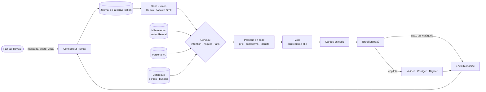
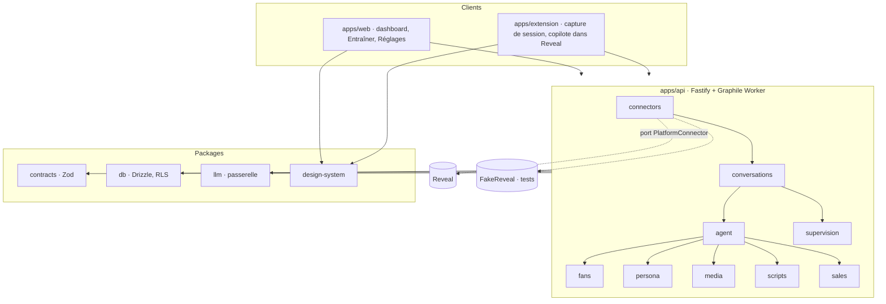
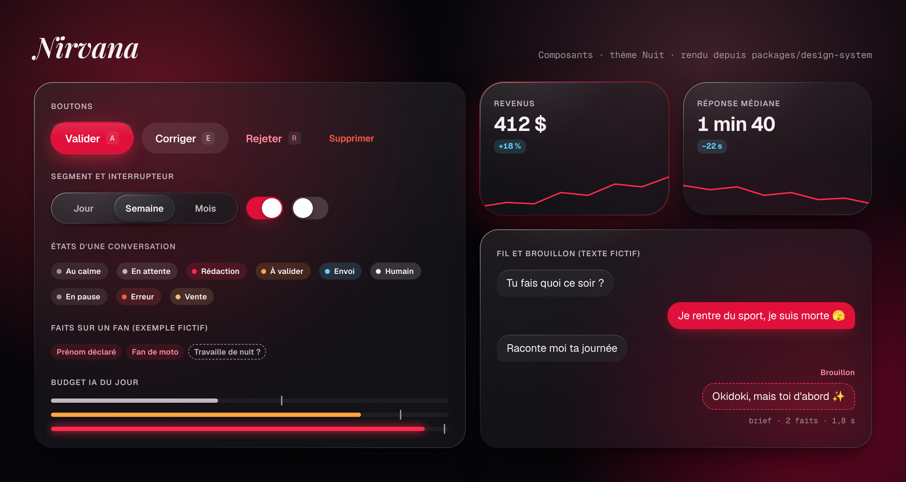

<p align="center">
  
</p>

<p align="center">
  
  
  
  
  
  
  
</p>

<p align="center">
  <b>Nirvana</b> est l'agent de chatting d'une créatrice de contenu.<br>
  Il fait connaissance avec chaque fan, s'en souvient, lui répond avec la voix de la créatrice, et vend ses médias privés au bon moment.<br>
  Copilote d'abord, autonome ensuite, jamais prisonnier d'une plateforme.
</p>

<p align="center">
  <a href="#où-on-en-est">État</a> ·
  <a href="#le-projet-en-une-minute">Le projet</a> ·
  <a href="#comment-il-répond">Fonctionnement</a> ·
  <a href="#modèles-ia">Modèles IA</a> ·
  <a href="#architecture">Architecture</a> ·
  <a href="#interface-et-design-system">Design</a> ·
  <a href="#démarrer">Démarrer</a> ·
  <a href="#feuille-de-route">Roadmap</a>
</p>

---

> **Session de code ?** Commence par [`CLAUDE.md`](CLAUDE.md), puis [`docs/00-START-HERE.md`](docs/00-START-HERE.md). Tout le reste en découle.

## Où on en est

État de `main` au 17 octobre 2026. Ce tableau ne liste que ce qui est dans le code ou dans une PR ; le reste est dans la [feuille de route](#feuille-de-route).

| | Quoi | Où |
|---|---|---|
| ✅ **Sur `main`** | **Socle du monorepo** : pnpm + Turborepo, TypeScript strict, frontières de modules vérifiées par ESLint (et testées), CI verte, gitleaks et lefthook. Les neuf modules de `apps/api` existent en squelette, le serveur Fastify répond sur `/health`. | P0-01 · #12, #14 |
| ✅ **Sur `main`** | **Premier agent, en terminal** : passerelle LLM multi-fournisseurs (`packages/llm`, Grok 4.7 par défaut, repli Mistral, coût de chaque appel, journal sans contenu), prompts voix et cerveau versionnés, message du fan isolé comme donnée (`wrapUntrusted`), gardes de sortie en code (aveu d'IA, « je t'aime », rencontre promise, coordonnées, tics d'IA, termes interdits de la persona, longueur), playground terminal et test express. | P3-01 · #16 |
| ✅ **Sur `main`** | **Persona** : un seul schéma Zod calqué sur la fiche créatrice d'OnlyChat (Détails, Infos en plus, Comportement, Stratégies, Relances, Notifications) et un placeholder qui le valide. | P0-08 · #17 |
| ✅ **Sur `main`** | **Design system** « Liquid Glass » (`packages/design-system`), logo et déclinaisons (`brand/`). | D-01 · #13 |
| ✅ **Sur `main`** | **Fiches validées** : mémoire du fan sur les notes Reveal (P3-02), catalogue de vente = index des scripts, étapes et bundles (P6-01). Fiche proposée : vocaux avec la voix clonée. | #18, #20, #21 |
| 🔶 **PR ouverte** | **Vision et anti-injection** : médias des fans décrits par Gemini 3.8 Flash avec bascule automatique vers Grok, fiche média par vidéo de bundle, pièges texte, image, vocal et caractères invisibles. | P3-04 · #19 (brouillon) |
| 🔶 **PR ouverte** | **Connexion Reveal** : inventaire de ce que Reveal expose, runbook de capture réseau anonymisée, spécification de `FakeReveal`. | #15 |
| ⏳ **Pas commencé** | Base de données et RLS, journal de conversation, worker, connecteur Reveal, dashboard, extension (seul le squelette du popup existe). | P0-02 → P0-07, P1 |

**Aucun message n'a encore été généré par Grok** : `pnpm probe` et `pnpm playground` attendent la clé `LLM_XAI_API_KEY` dans l'environnement. Le premier verdict sur le sexting en français viendra de là.

## Le projet en une minute

Une créatrice sur Reveal.me reçoit chaque jour des dizaines de conversations privées. Chaque fan attend une réponse personnelle, rapide, qui se souvient de lui. C'est ce qui fidélise, et c'est ce qui fait acheter les médias privés. Impossible à tenir seule, difficile à déléguer sans perdre sa voix.

Nirvana incarne la créatrice (Messalina pour commencer) :

- **la relation d'abord** : il fait connaissance (prénom, ville, métier, passions, envies) avant de proposer quoi que ce soit, et note ce qu'il apprend dans les notes client de Reveal ;
- **il vend comme une vraie chatteuse** : scripts Jour et Nuit, bundles préparés à prix fixe, jamais de négociation, jamais deux fois le même média au même fan, aftercare après chaque vente ;
- **il ne sort jamais du personnage** : le bot ne dit jamais qu'il est une IA ([ADR 0012](docs/adr/0012-identity-policy-config.md)), ne promet ni amour ni rencontre, et coupe toute pression commerciale face à un fan en détresse, en difficulté d'argent ou peut-être mineur ;
- **il propose avant d'envoyer** : une personne valide d'un geste, puis l'agent gagne son autonomie catégorie par catégorie, quand le taux de messages envoyés sans retouche dépasse 80 % ;
- **tout est tracé** : chaque réponse garde son brief, les faits utilisés, le modèle et le coût, pour répondre à « pourquoi a-t-il dit ça ? ».

Le bot n'envoie que du texte, des étapes de scripts et des notes ; jamais de média choisi librement. Comment le moteur décide : [`docs/architecture/ai-engine.md`](docs/architecture/ai-engine.md).

## Comment il répond



Les règles métier vivent dans le code, pas dans les prompts : un prompt reçoit des décisions déjà prises (vendre ou non, quelle étape, quel prix) et n'écrit que le texte. Le message du fan entre dans le prompt comme une donnée délimitée, jamais comme une instruction.

## Modèles IA

Une seule passerelle (`LlmGateway`), un modèle par rôle, changeable sans toucher au cœur ([ADR 0009](docs/adr/0009-llm-gateway-three-roles.md)).

| Rôle | Modèle | Repli | État |
|---|---|---|---|
| Voix et cerveau | **Grok 4.7** (xAI) | Mistral Large | codé, en attente de la clé |
| Vision (photos, vidéos, vocaux des fans et des bundles) | **Gemini 3.8 Flash** | Grok 4.7, bascule automatique | PR #19 |
| Vocaux avec la voix clonée de la créatrice | **ElevenLabs v4**, en copilote obligatoire | banque de vrais vocaux | fiche proposée |

Aujourd'hui les clés passent par les variables d'environnement (`.env.example`). Prévu : brancher Grok, Gemini et ElevenLabs depuis Réglages › Modèles IA, avec des clés chiffrées côté serveur (ADR en préparation). L'extension ne porte jamais de clé.

## Architecture

Un **monolithe modulaire** TypeScript. Chaque module a un domaine pur, des cas d'usage et une infrastructure, et n'expose que son `index.ts` ; ESLint refuse tout import qui traverse une frontière. Le cœur ne connaît aucune plateforme : Reveal est un adaptateur derrière un port, notre future plateforme en sera un autre ([ADR 0003](docs/adr/0003-platform-agnostic-core.md)).



Les principes qui structurent tout ([`docs/architecture/overview.md`](docs/architecture/overview.md)) :

1. **Journal d'événements** par conversation, append-only, source de vérité ; les tables d'état sont des projections ([ADR 0007](docs/adr/0007-conversation-event-log.md)).
2. **Un seul écrivain par conversation** : file série Graphile Worker sur Postgres ([ADR 0006](docs/adr/0006-graphile-worker-per-conversation-queues.md)).
3. **Reveal par session capturée** : l'extension capture la session du chatteur « bot », un client serveur l'utilise avec rythme humain et coupe-circuit, Playwright en repli ([ADR 0008](docs/adr/0008-platform-connector-port-and-reveal-strategy.md)).
4. **Isolation par créatrice** garantie par la base (RLS), pas par la discipline ([ADR 0005](docs/adr/0005-postgres-drizzle-rls.md)).
5. **La persona est une donnée versionnée**, hors dépôt pour la vraie ([ADR 0010](docs/adr/0010-persona-as-versioned-data.md)).

| Couche | Choix |
|---|---|
| Langage | TypeScript strict, Node 22, pnpm 10 + Turborepo |
| API et jobs | Fastify 5, Zod 4, Graphile Worker |
| Données | PostgreSQL 16, Drizzle, RLS par créatrice |
| IA | Vercel AI SDK derrière `LlmGateway` |
| Interface | Vite, React 19, TanStack, Tailwind v4, shadcn/ui |
| Extension | WXT (Chrome, Manifest V3) |
| Qualité | Vitest, Testcontainers, Promptfoo |
| Hébergement | Hetzner + Coolify |

## Interface et design system

Les écrans de l'application n'existent pas encore ; le design system, si. **Liquid Glass sur une nuit chaude, un seul néon rouge** : surfaces translucides, bords lumineux, animations à ressort, et un test qui garantit le contraste AA dans les deux thèmes. Les images ci-dessous sont rendues depuis le CSS du package, avec des textes fictifs.

<p align="center">
  
</p>

<table>
  <tr>
    <td width="50%"></td>
    <td width="50%"></td>
  </tr>
</table>

- **Logo** : la flamme à l'auréole dessinée par Charles, nom en Playfair Display italique éclairé par la flamme. Fichiers et règles : [`brand/`](brand/README.md).
- **Polices** : Geist pour l'interface, Geist Mono pour les chiffres, Instrument Serif italique pour les états vides. Icônes Lucide.
- **Navigation prévue** : Dashboard, Créatrices, Entraîner (Playground, Corrections, Tests, Comparer), Suivi, Réglages. Pas d'Inbox : la validation en copilote est prévue dans Reveal, par l'extension.
- Guide complet, avec le thème Jour et la typographie : [`docs/design/README.md`](docs/design/README.md). Code : [`packages/design-system`](packages/design-system).

## Structure du dépôt

```
├── CLAUDE.md                 règles des sessions de code
├── apps/
│   ├── api/                  Fastify + worker ; src/modules/<module>/{domain,application,infra,index.ts}
│   ├── web/                  Vite · React 19 · Tailwind v4 (squelette)
│   └── extension/            Chrome MV3 avec WXT (squelette du popup)
├── packages/
│   ├── contracts/            schémas Zod partagés, dont PersonaSchema
│   ├── db/                   Drizzle, migrations, RLS (squelette)
│   ├── design-system/        tokens, pont Tailwind v4, classes nv-*, aides d'animation
│   └── llm/                  passerelle, fournisseurs, prompts versionnés, journal des appels
├── personas/                 placeholders seulement (la vraie persona est hors dépôt)
├── evals/                    test express (probe) et évaluations Promptfoo
├── brand/                    logo, lockups, favicon, bannière
├── brainstorm/               01 → 06 : les échanges de conception, figés
└── docs/
    ├── 00-START-HERE.md      quoi lire selon la tâche
    ├── architecture/         vue d'ensemble, modules, données, connecteurs, moteur IA, menaces
    ├── adr/                  15 décisions (14 acceptées, 1 proposée)
    ├── conventions/          code, tests, git, sécurité, hygiène
    ├── design/               guide du design system et ses images
    ├── reference/            OnlyChat, schéma persona, fournisseurs LLM, Reveal
    ├── playbooks/ runbooks/  gestes courants et incidents
    ├── sessions/             fiches de tâches, journal par session
    └── roadmap.md
```

## Démarrer

Node 22.13 ou plus (`.nvmrc`), pnpm 10, Docker.

```bash
pnpm install            # dépendances + hooks git (lefthook)
pnpm check              # typecheck, lint des frontières, prettier, knip, cohérence des docs
pnpm test               # tests unitaires
pnpm probe              # test express : Grok 4.7 accepte-t-il le sexting en français ? (clé requise)
pnpm playground         # converser avec l'agent dans le terminal (clé requise)
```

Les clés vont dans `.env` (jamais commité, documenté par `.env.example`). `docker compose up -d`, `pnpm dev` et `pnpm db:migrate` serviront quand la base et le serveur auront leur code (P0-03, P0-04).

## Comment on travaille ici

- **Une session = une fiche de tâche = une branche = une PR.** Les fiches ([`docs/sessions/tasks/`](docs/sessions/tasks/)) disent quoi lire, quoi faire et comment on sait que c'est fini.
- **Une décision structurante = une ADR.** On ne contredit pas une ADR acceptée, on en écrit une nouvelle.
- **La doc dit vrai.** Si le code et la doc divergent, la PR corrige la doc ; `scripts/check-repo.mjs` vérifie que la doc ne cite que des commandes qui existent.
- **Rien de privé dans le dépôt** : ni vraie persona, ni conversation, ni fan, ni voix, ni clé.
- **Code en anglais, docs et interface en français.** Le [glossaire](docs/glossary.md) fait le pont.

## Feuille de route

| Phase | Objectif | État |
|---|---|---|
| **0 · Fondations** | monorepo, contrats, base + RLS, serveur + worker, journal, port connecteur, CI | outillage fait, le reste à faire |
| **1 · Spike Reveal** | capture et analyse de l'API Reveal, FakeReveal | inventaire en PR #15, capture attend le compte « bot » |
| **2 · Connecteur** | lecture temps réel, envoi vérifié, session chiffrée, coupe-circuit | — |
| **3 · Moteur IA en copilote, vente comprise** | sens, cerveau, voix, gardes, mémoire, scripts et bundles ; ≥ 80 % sans retouche au test à l'aveugle | passerelle et gardes faites, vision en PR #19 |
| **4 · Supervision** | dashboard façon Reveal, Entraîner, Suivi, Réglages › Modèles IA, copilote dans l'extension | maquettes et design system |
| **5 · Autonomie et mobile** | auto par catégorie, horaires de vie, relances, appli de la créatrice | — |
| **6 · Commerce avancé** | customs, pourboires, envois de masse, reporting | — |
| **7 · Instagram** | veille, idées de reels, commentaires | — |
| **8 · Plateforme propre** | notre site, connecteur in-process, paiements | — |

Détail et critères d'acceptation : [`docs/roadmap.md`](docs/roadmap.md).

## Qui

- **Pour** Messalina, créatrice de contenu.
- **Conçu et dirigé par** [Charles Altman](https://github.com/LeyZee), co-fondateur d'[IMPERA Agency](https://impera-agency.com). Il porte la vision produit, les décisions et la revue.
- **Architecture, documentation et code** : sessions Claude, une fiche de tâche à la fois, sous les règles de ce dépôt.
- **Héritage** : des concepts d'Imperium et d'OnlyScript, et l'expérience d'OnlyChat, sans réutilisation de code.

## Licence

Privé. Tous droits réservés, IMPERA Agency, 2026.
