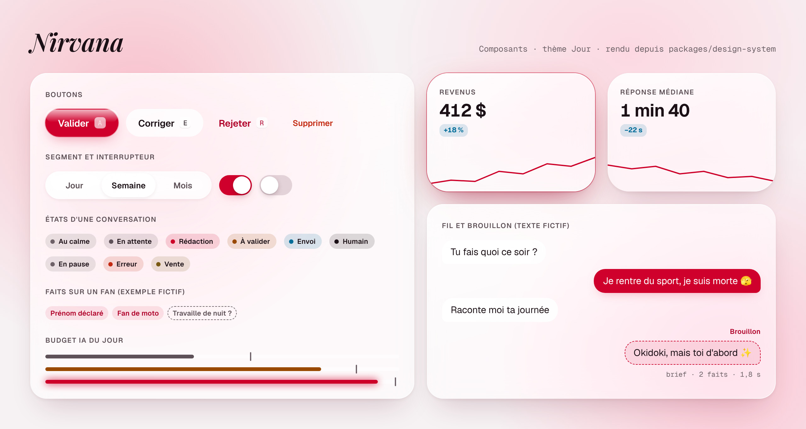

# Guide design : Nirvana « Liquid Glass »

Dernière revue : 2026-10-17. Fiche : D-01. Code : `packages/design-system` (ADR 0015, proposed).

## En images

Rendus du package lui-même (`tokens.css`, `components.css`, polices du design system) dans Chromium, à 2×, mouvement réduit ; textes fictifs. Ce ne sont pas des captures de l'application, qui n'existe pas encore. Si une image et le CSS divergent, le CSS a raison et l'image est à refaire.

## Décisions de Charles (2026-10-16)

Réponses aux questions ouvertes de `brief.md` :

- **Identité propre à Nirvana**, pas les tokens IMPERA. Direction : le Liquid Glass d'iOS 26/27 sur une nuit chaude, avec **un seul accent, un néon rouge**. L'ancienne bannière violette du README n'est plus la référence de couleur ; la bannière actuelle est `brand/banner.svg`.
- **En code, sans Figma.** La référence visuelle vivante est l'artifact « Nirvana » (design system publié par Claude, privé au compte de Charles : https://claude.ai/artifact/Aw5XKd8jae4xSNevjge2Ci). Le dépôt fait foi : si l'artifact et `packages/design-system` divergent, c'est le dépôt qui a raison.
- Nom et logo : la flamme à l'auréole dessinée par Charles (16/10), déclinée dans `brand/` (règles d'usage dans `brand/README.md`). Le nom s'écrit en Playfair Display italique 600 (`.nv-wordmark`), la police du logo, choisie par Charles le 16/10 parce que ses pleins et ses pointes reprennent la flamme ; les lockups de `brand/` en portent le tracé vectorisé.

## Retours de Charles sur le prototype (2026-10-17)

Prototype cliquable : https://claude.ai/artifact/TZjCUAPFhxN4pJn978A9zz (brainstorm/06). Ce qu'il a fixé :

- **Le dashboard n'a ni Inbox ni page Fans.** Navigation : Dashboard (statistiques), Créatrices, Entraîner, Suivi, Réglages. La validation en copilote passe par l'extension, dans Reveal (proposition de la note 06, à valider).
- **Un dashboard de statistiques à la manière de celui de Reveal**, animé (voir « Dashboard » plus bas).
- **Pas de double bouton sur le verre** : un bouton secondaire posé sur une surface vitrée est une teinte (`nv-btn--soft`), pas un second verre.
- **Chaque icône de navigation a son geste** quand on l'active, et les changements d'onglet s'animent.
- Le rendu doit faire moderne et propre : c'est le critère de chaque revue visuelle.
- **Rien ne déborde** : un texte long passe à la ligne ou se coupe avec des points de suspension, jamais au-delà de sa carte, à 1 440 px comme à 400 px.
- **Supprimer se confirme dans la page** : `nv-confirm` dit ce qui se passe (ce qui s'arrête, ce qui est gardé, combien de temps c'est restaurable) ; pour une créatrice active, on tape son nom avant que le bouton s'ouvre. Une suppression archive 30 jours, puis efface.
- **Santé et coûts se lisent en deux secondes** (Réglages › Modèles IA) : d'abord « est-ce que ça marche », puis « combien ça coûte », puis « quel modèle fait quoi ». La jauge de budget `nv-gauge` reste neutre sous 70 %, passe en ambre de 70 à 90 % et en néon au-delà ; son repère montre la projection à minuit.

## Retours de Charles sur le CRM (2026-10-17, soir)

Donnés sur la maquette du Dashboard (fil de revue 08), valables pour tout le CRM :

- **Tout réagit à l'utilisateur** : chaque élément cliquable a un survol, une pression et un focus visibles, et rien n'apparaît sans animation. Les classes communes sont dans « États » plus bas ; un écran n'en invente pas d'autres.
- **On ne doit pas se noyer dans l'information** : chaque écran a une hiérarchie nette (section « Hiérarchie »).
- **Les graphiques sont animés, ont des survols et sont beaux** : un seul composant, `nv-chart` (section « Graphiques »), jamais une courbe brute.

## Où vivent les choses

| Fichier                                                 | Rôle                                                                                                                                                |
| ------------------------------------------------------- | --------------------------------------------------------------------------------------------------------------------------------------------------- |
| `packages/design-system/src/styles/tokens.css`          | **Seule source des valeurs** : variables `--nv-*`, Nuit par défaut, Jour sous `data-theme="light"`.                                                 |
| `packages/design-system/src/styles/theme.css`           | Pont Tailwind v4 : `bg-void`, `text-ink-muted`, `bg-neon-solid`, `rounded-lg`, `shadow-glass`, `backdrop-blur-regular`, `ease-spring`, `text-body`… |
| `packages/design-system/src/styles/components.css`      | Classes `nv-*` sans framework, appliquées aux composants shadcn/ui par `className`.                                                                 |
| `packages/design-system/src/index.ts`                   | Aides d'animation sans état (lumière du verre, déformation liquide, lentille, Island).                                                              |
| `packages/design-system/src/__tests__/contrast.test.ts` | Vérifie le contraste AA de chaque paire ci-dessous, dans les deux thèmes.                                                                           |

Les consommateurs et l'ordre d'import sont dans `packages/design-system/README.md`.

## Principes

1. **La nuit d'abord.** Nuit est le thème par défaut (usage le soir) ; Jour existe pour le bureau en plein jour.
2. **Un seul néon.** `neon` est une lumière, pas un remplissage. Une action néon par écran (`nv-btn--neon`), une surface teintée par écran (`nv-glass--neon`).
3. **Le verre a besoin de lumière.** Une surface de verre est posée sur `nv-aura` ou sur du contenu, jamais sur un aplat.
4. **La matière bouge, l'interface reste calme.** Ce qui se déplace (pouce, lentille, Island) se déforme sur un ressort ; le reste ne fait que des fondus.
5. **Le travail de l'IA se voit dans le dashboard.** Un brouillon garde son pointillé et son étiquette jusqu'à l'envoi vérifié (`send_verified`). C'est une information pour l'opérateur, pas un texte montré au fan (la politique d'identité, ADR 0012, ne change pas).

## Hiérarchie

Un écran se lit en deux secondes : ce qui compte, puis quoi faire. Trois niveaux, jamais plus :

1. **Ce qui domine** : un chiffre ou une action, un seul par écran. Le chiffre est grand (`metric` ou plus), l'action est le seul bouton néon. Deux néons visibles en même temps veulent dire que l'écran ne sait pas ce qu'il demande.
2. **Le travail en cours** : le contenu sur lequel on agit (une conversation, une liste à traiter), en `ink`, taille `body`.
3. **Le reste en retrait** : réglages, détails, métadonnées. En `ink-faint`, taille `footnote` ou `caption`, et **replié** par défaut (`nv-disclosure`) avec une ligne de résumé qui répond à « qu'y a-t-il dedans ? » sans l'ouvrir.

Règles pratiques :

- Une information secondaire se montre au survol ou en dépliant, pas en permanence (version, coût, latence, modèle).
- Une liste de choix longue se replie sur le choix fait ; on la déplie pour changer.
- Pas plus de trois chiffres secondaires côte à côte ; au-delà, une bande `nv-meta` ou un pli.
- Les titres de section sont des sourcils (`nv-eyebrow`, capitales espacées, `ink-faint`) : ils guident l'œil, ils ne l'attirent pas.
- Un état vide dit quoi faire et propose l'action (un bouton ou une suggestion cliquable), pas seulement « rien ici ».

## Couleur

| Token                                                                                                         | Usage                                                                                                        |
| ------------------------------------------------------------------------------------------------------------- | ------------------------------------------------------------------------------------------------------------ |
| `void`, `abyss`, `surface-raised`                                                                             | Fond de page ; colonnes encastrées ; cartes opaques et repli « Réduire la transparence ».                    |
| `ink`, `ink-muted`, `ink-faint`                                                                               | Texte principal ; secondaire ; métadonnées (heures, sources de faits, placeholders), jamais sous 11px.       |
| `neon`                                                                                                        | Halos, icônes actives, curseur, point « Rédaction ». Texte seulement à partir de 15px.                       |
| `neon-solid` + `on-neon`                                                                                      | Bouton principal, interrupteur activé, bulle de la créatrice.                                                |
| `neon-ink` sur `neon-soft`                                                                                    | Petites étiquettes néon : « Brouillon », onglet actif, fait déclaré.                                         |
| `glass-veil`, `glass-fill`, `glass-fill-strong`, `glass-thick`, `glass-edge`, `glass-specular`, `glass-sheen` | Matière du verre (voir plus bas).                                                                            |
| `aura-neon`, `aura-wine`, `aura-rose`                                                                         | Lueurs floues derrière le verre.                                                                             |
| `success` (cyan), `warning`, `danger`, `sale`                                                                 | Envoi vérifié ; à valider ; erreur ; vente. Toujours avec un mot ou une icône : `danger` est proche du néon. |
| `focus`                                                                                                       | Anneau de focus, 2px plein, décalé de 3px.                                                                   |

Contraste garanti par le test : `ink`, `ink-muted`, `ink-faint` ≥ 4,5:1 sur `void`, `abyss`, `surface-raised` et sur le verre au pire cas (au-dessus du point le plus lumineux de l'aura) ; `neon`, `neon-ink`, `danger`, `success`, `warning`, `sale` ≥ 4,5:1 sur `void` ; `on-neon` ≥ 4,5:1 sur `neon-solid` ; `focus` ≥ 3:1 sur `void` et `surface-raised`. Modifier un token qui casse une paire fait échouer `pnpm test`.

## Le verre : où oui, où non

| Épaisseur | Classe                     | Pour                                                                                                    |
| --------- | -------------------------- | ------------------------------------------------------------------------------------------------------- |
| Fin       | `nv-glass nv-glass--thin`  | Lentilles, pouces, petits boutons.                                                                      |
| Régulier  | `nv-glass`                 | Barre latérale, en-têtes, cartes flottantes, conteneur de liste, panneau de brouillon, champ de saisie. |
| Épais     | `nv-glass nv-glass--thick` | Island (notification), menus, dialogues.                                                                |

- **Oui** : les surfaces de chrome (barres, panneaux, cartes flottantes, conteneurs).
- **Non** : chaque ligne d'une liste (`nv-convo` n'a pas de `backdrop-filter`, c'est le conteneur qui est vitré) ; chaque bulle d'un fil (`nv-bubble--fan` imite le verre sans flou : un fil peut compter des centaines de bulles).
- Deux couches de verre empilées au plus. Pas de bordure ajoutée : le liseré spéculaire fait le contour.
- **Un contrôle posé sur du verre n'est pas du verre** : boutons secondaires `nv-btn--soft`, onglets et segments en `glass-fill`. Deux liserés spéculaires l'un dans l'autre se lisent comme un double bouton (relevé par Charles le 17/10).
- Une page d'application pose son contenu sur `nv-aura` : sans lueur derrière, le verre n'a rien à réfracter et ressemble à un gris plat.
- Le voile `glass-veil` sous le remplissage est ce qui garde le texte lisible sur une aura vive. Ne pas le retirer.
- `prefers-reduced-transparency` remplace le verre par `surface-raised`.

## Typographie, espacement, rayons

- **Geist** pour l'interface (`text-body` 15/21 par défaut), titres serrés (`large-title`, `title-1`, `title-2`). **Playfair Display italique 600** pour le nom seul (`nv-wordmark`, `font-wordmark`). **Instrument Serif italique** pour les états vides (`whisper`). Ni l'une ni l'autre pour un bouton ou un message. **Geist Mono** pour les chiffres et métadonnées, chiffres tabulaires. Plancher : `caption` 11px.
- Grille de 4px (`space-1` à `space-12`).
- Tout ce qui se touche est une capsule (`radius-full`) ; bulles `radius-md`, cartes `radius-lg`, Island et dialogues `radius-xl`. Rayons concentriques : rayon intérieur = rayon extérieur − padding.

## États

Tout élément cliquable a les quatre états ; un écran prend la classe qui convient au lieu d'écrire les siens.

- **Survol** : bouton néon, halo `shadow-neon` → `shadow-neon-strong` et +8 % de lumière ; autres boutons, teinte `glass-fill` ; bouton rond `nv-iconbtn`, grossit de 6 % ; ligne ou carte cliquable (`nv-tap`), `glass-fill` ; carte flottante (`nv-lift`), monte de 2px avec `shadow-lift`.
- **Focus clavier** : anneau `focus` sur tout élément interactif, champs compris (`shadow-focus`). Visible sur verre dans les deux thèmes.
- **Actif** : `scale(0.96)` (boutons), `0.95` (puces), `0.985` (lignes) en `dur-instant`, retour sur `ease-spring`.
- **Sélection** : `neon-soft` (conversation ouverte, onglet actif, puce cochée `aria-checked`).
- **Désactivé** : opacité 0,4, sans ombre ni survol. Pendant un envoi, le bouton reste visible avec un libellé d'état.

Classes communes : `nv-btn` (actions), `nv-chip` (un choix parmi quelques-uns), `nv-tap` (ligne, carte, élément de liste), `nv-lift` (carte flottante, pas un grand panneau), `nv-disclosure` (pli `
` avec titre `__title`, résumé `__sum` et contenu `__body`), `nv-enter` (entrée en fondu montant, décalée par `--nv-i`).

Pastilles d'état (`nv-status--<état>`) : une par valeur de `conversations.state` (`data-model.md`) : `idle`, `pending`, `drafting` (respire), `awaiting-approval`, `sending` (respire), `human`, `paused`, `error`, plus `sale`. Libellés : Au calme, En attente, Rédaction, À valider, Envoi, Humain, En pause, Erreur, Vente.

## Mouvement

- Durées : `dur-instant` (pression), `dur-fast` (couleurs), `dur-base` (états), `dur-slow` (déplacement de matière), `dur-ambient` (aura).
- Courbes : `ease-spring` pour ce qui se déplace ou change de taille, `ease-spring-bouncy` pour les pouces d'interrupteur et l'Island, `ease-out` pour les apparitions.
- Signature : pression à ressort ; pouces et lentilles qui s'écrasent pendant leur trajet (`playLiquid`) ; bulles qui montent de 8px en entrant ; Island qui naît d'une capsule ; aura qui dérive.
- **Le verre ne ralentit jamais le clavier** : approuver, éditer, rejeter, suivant, précédent ne déclenchent aucune animation bloquante ; le focus passe au brouillon suivant immédiatement.
- **Changement de page** : la lentille de la barre de navigation glisse et s'étire sur son trajet (`playLiquid`), la page entre en fondu en montant de 10px, ses blocs décalés de 40ms.
- **Icônes de navigation** : chacune a un geste propre, joué une fois à l'activation par la classe `is-playing` (`playOnce`) ; l'icône active prend `neon-ink` et un halo. Geste lié au sens : Dashboard, les barres repoussent ; Entraîner, l'étoile pivote et les petites scintillent ; Suivi, l'aiguille balaie le cadran et se pose ; Réglages, l'engrenage tourne d'un cran. Une nouvelle icône de navigation arrive avec son geste.
- **Chiffres** : une statistique compte jusqu'à sa valeur (`countUp`, `easeOutQuart`) et, au changement de période, part de l'ancienne valeur, pas de zéro. Les courbes se dessinent (`nv-draw`), les aires apparaissent en fondu, les barres poussent depuis leur base, décalées.
- **Pastilles d'état global** : fixes en vert (le calme ne bouge pas), elles respirent en ambre et pulsent en rouge ; un changement d'état est une transition de couleur de 300 ms, sans secousse.
- `prefers-reduced-motion` : ressorts instantanés, boucles arrêtées ; tout reste lisible au repos.

## Dashboard (statistiques)

Inspiré du tableau de bord de Reveal, sur le verre Nirvana :

- En tête : période (Jour, Semaine, Mois) en segment, sélecteur de période à flèches.
- Quatre cartes `nv-stat` : la plus importante en `nv-stat--hero` (une seule par écran, comme le bouton néon), chacune avec sa valeur, une `nv-delta` comparée à la période précédente et une courbe collée au bas de la carte.
- Une bande de chiffres secondaires dans un seul verre, séparés par des filets.
- Graphiques : courbe de la période contre la précédente (pointillés), curseur et bulle au survol ; répartition en anneau ; barres par heure ; classement des fans avec la part vendue par l'agent.
- `nv-delta--better` / `--worse` suivent le sens « mieux », pas le signe : un temps de réponse qui baisse est en `--better`.
- Couleurs des graphiques : le néon pour la série principale, `sale` en second, puis `ink` à 60 % et 25 %. Jamais deux rouges.

## Graphiques

Un seul composant, `nv-chart` : un SVG dessiné avec les aides de `@nirvana/design-system` (`chartPoints`, `linePath` monotone qui ne dépasse jamais les vraies valeurs, `areaPath`, `niceTicks`, `nearestIndex`) et animé par les classes.

- **Apparition** : la courbe se dessine (`nv-chart__line`, `pathLength="1"`), l'aire apparaît en fondu juste après (`__area`), les barres poussent depuis leur base à 40ms d'intervalle (`__bar`, `--nv-i`). La période précédente est en pointillés discrets (`__line--past`).
- **Survol** : `is-hovering` sur le conteneur montre un curseur vertical (`__cursor`), un point sur la courbe (`__dot`) et une bulle de verre avec la valeur et sa date (`__tip`, placée par `--nv-tip-x` / `--nv-tip-y` d'après `nearestIndex`). Survoler une barre l'éclaire et met les autres en retrait. Au doigt, toucher et glisser fait de même.
- **Couleur** : `--_c`, le néon par défaut ; une seconde série en `sale`, puis `ink` à 60 % et 25 %. Jamais deux rouges. Grille en `hairline`, axes en `caption` mono `ink-faint`.
- **Mouvement réduit** : tout est dessiné d'emblée ; le survol reste.

## Copilote et raccourcis

- Raccourcis communs au playground et au copilote : `a` valider, `e` corriger, `r` rejeter. Chaque bouton affiche sa touche (`nv-kbd`).
- La proposition montre le brief en une ligne, le fil, le brouillon étiqueté, puis les faits utilisés et la latence en `nv-meta`.
- Cibles ≥ 44px : les contrôles compacts (`nv-btn--sm`, `nv-iconbtn`, `nv-switch`) gardent une zone de clic de 44px autour d'un visuel plus petit.

## Correspondance avec shadcn/ui

Quand D-01 initialisera shadcn/ui dans `apps/web`, ses variables sémantiques pointent vers les tokens (et non l'inverse) :

| shadcn                               | Nirvana                                                        |
| ------------------------------------ | -------------------------------------------------------------- |
| `--background` / `--foreground`      | `--nv-void` / `--nv-ink`                                       |
| `--card`, `--popover`                | `--nv-surface-raised` (les cartes vitrées ajoutent `nv-glass`) |
| `--primary` / `--primary-foreground` | `--nv-neon-solid` / `--nv-on-neon`                             |
| `--muted-foreground`                 | `--nv-ink-muted`                                               |
| `--accent`                           | `--nv-neon-soft`                                               |
| `--destructive`                      | `--nv-danger`                                                  |
| `--border`, `--input`                | `--nv-hairline`, `--nv-fill-track`                             |
| `--ring`                             | `--nv-focus`                                                   |
| `--radius`                           | `--nv-radius-lg`                                               |

Le bloc de couleurs généré par `shadcn init` est supprimé au profit de cette correspondance : une seule source.

## Extension Chrome

Le popup (capture de session, enregistreur) importe `@nirvana/design-system/styles.css` : en-tête `nv-popup__brand`, état de la session (`platform_session` : valide, à surveiller, expirée) en `nv-status`, un bouton néon « Synchroniser la session ». Pas de verre au-dessus de Reveal : l'extension n'injecte aucun style dans la page Reveal.

## Ce qui reste (fiche D-01)

Débloqué depuis P0-01 (#14, `apps/web` et `apps/extension` initialisées), pas encore fait : restylage des composants shadcn/ui, page `_playground.tsx`, test axe-core en CI, `brand/favicon.svg` dans `public/` des apps, auto-hébergement des polices si la politique réseau du dashboard l'exige.
