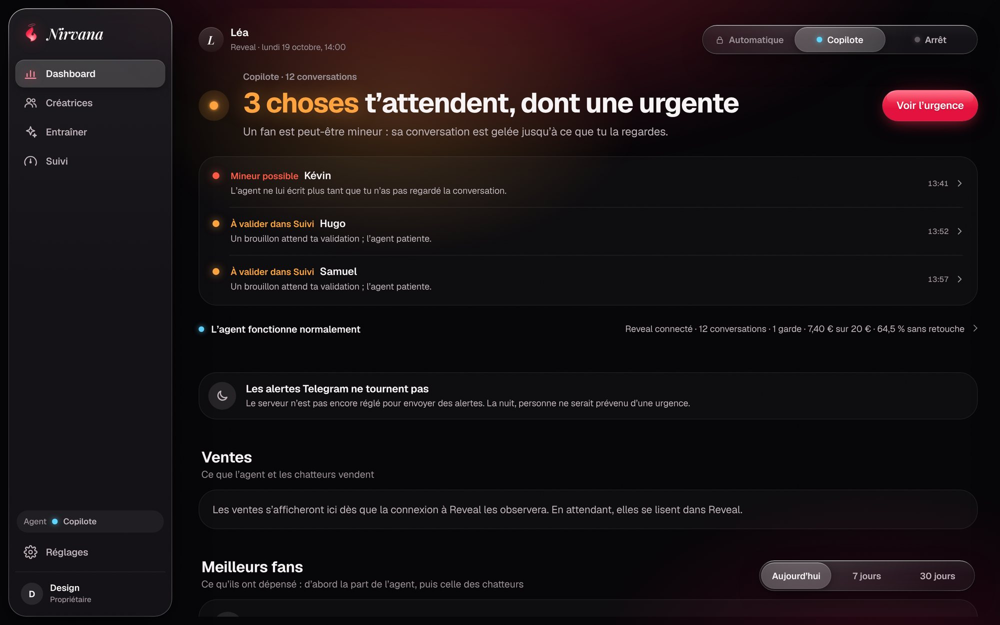
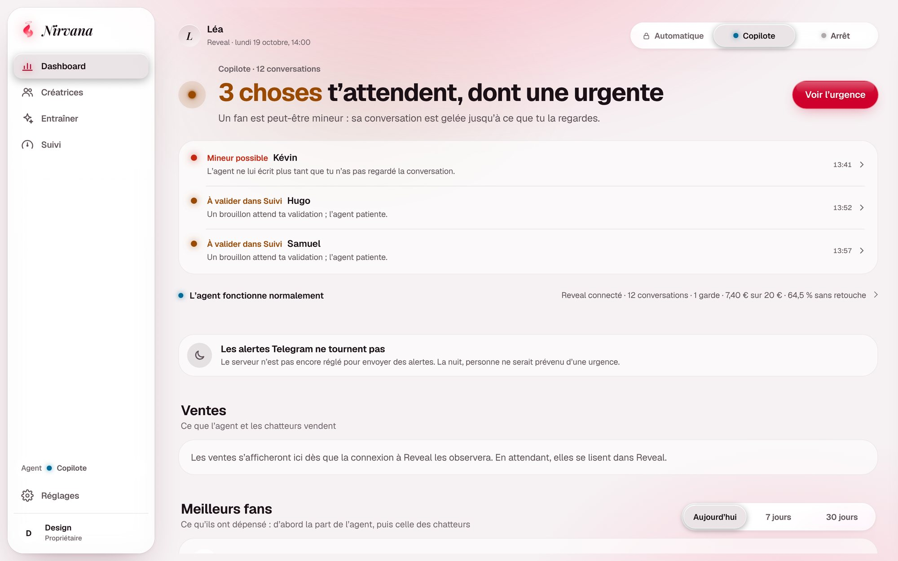
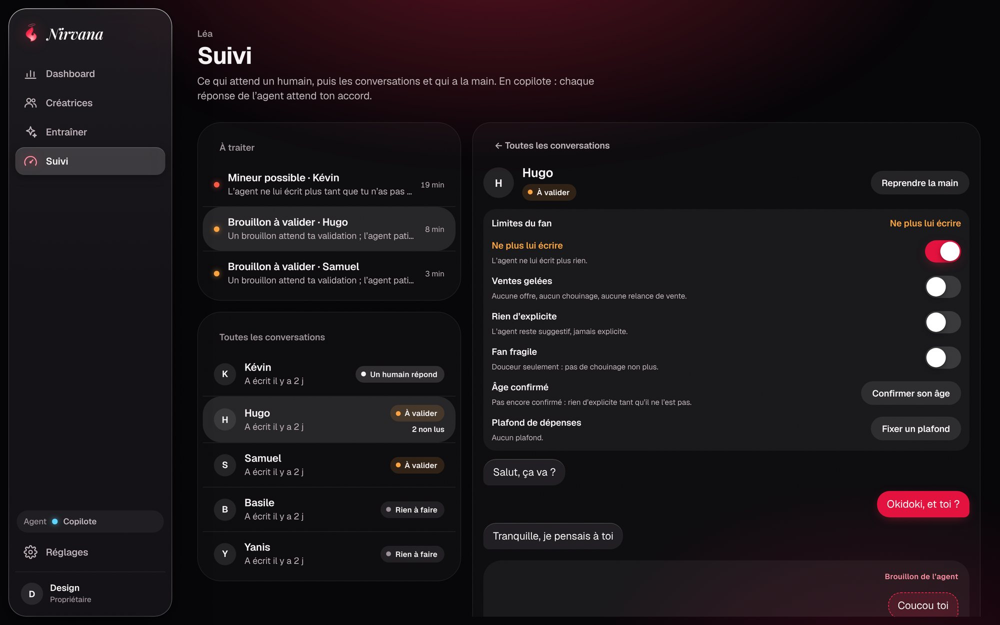
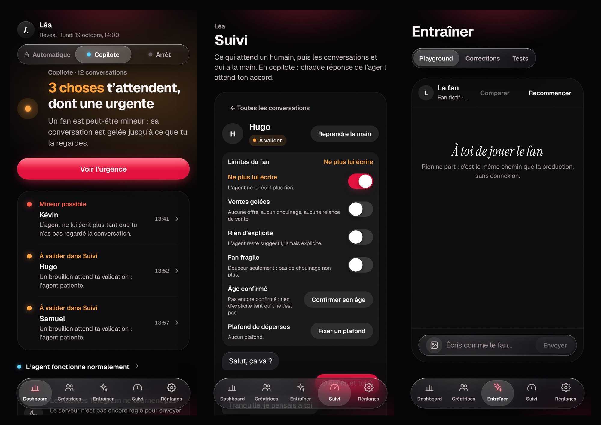
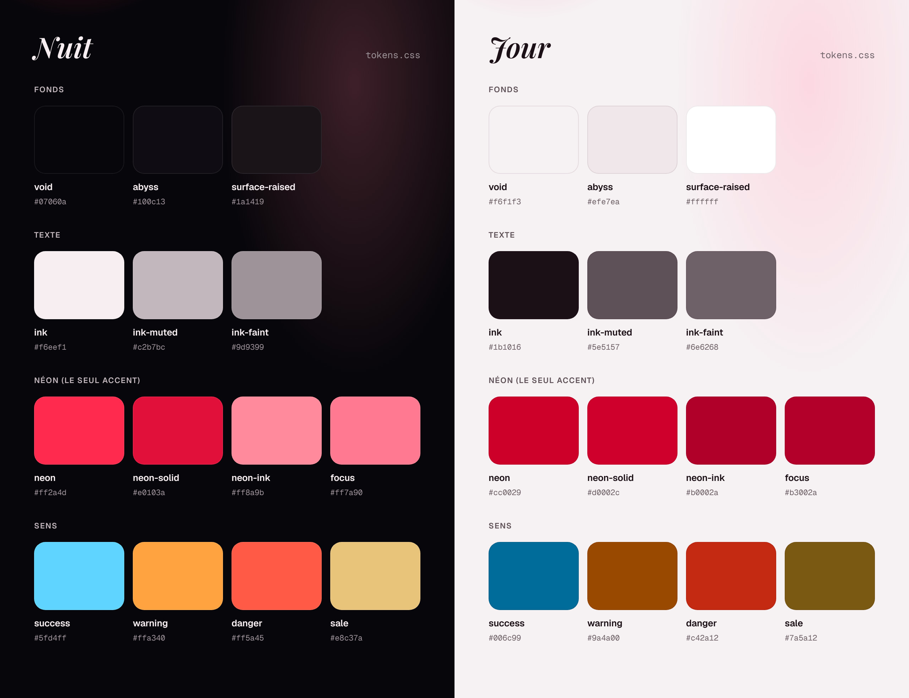
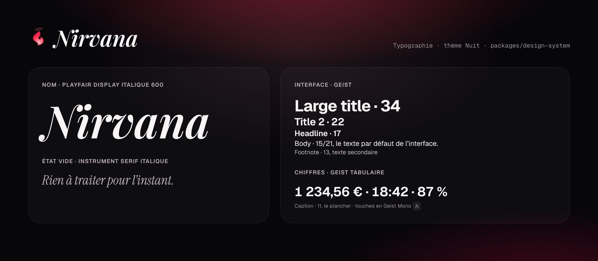
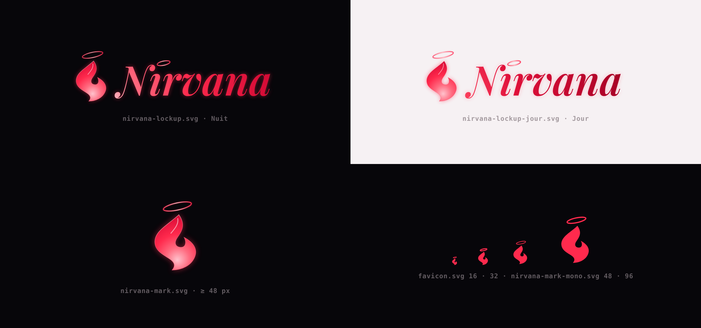

# Guide design : Nirvana « Liquid Glass »

Dernière revue : 2026-10-25 (images refaites depuis le CRM). Fiche : D-01. Code : `packages/design-system` (ADR 0015).

## En images

Captures du CRM refait (23/10), prises dans Chromium à 2×, mouvement réduit, avec des données inventées (prénoms fictifs, aucune vraie conversation). La palette et la typographie sont rendues depuis le package lui-même : les valeurs affichées sont lues dans `tokens.css` au moment de la capture. Si une image et le CSS divergent, le CSS a raison et l'image est à refaire.

## Refonte du 19/10 : le Liquid Glass d'Apple

Demandée par Charles le 19/10 : le CRM faisait « cheap » et « daté ». La revue a trouvé cinq causes : tout était en verre, ce verre était laiteux et plat, le rouge servait à tout, aucun bloc ne dominait, et la barre latérale avait l'allure d'un tube à libellés. La refonte suit ce qu'Apple fait dans iOS 26 et 27 (HIG Materials, WWDC25 « Meet Liquid Glass » et « Get to know the new design system », changements d'iOS 27) et garde l'identité : nuit chaude, néon rouge, Geist, flamme.

- **Deux couches.** Le verre (`nv-glass`) est réservé à la couche qui flotte : navigation, barres d'outils, contrôles (segments, sous-onglets), menus, info-bulles, feuilles, dialogues. Le contenu (listes, chiffres, formulaires, graphiques) n'est pas en verre : il se pose sur le fond, groupé par l'espace, ou sur une plaque (`nv-plate`), un souffle de lumière et un filet, sans flou ni ombre.
- **Un verre clair, pas laiteux.** Voile léger, saturation forte (les couleurs derrière restent vivantes), reflet spéculaire sur le bord haut et, plus doux, sur le bord bas, et un fin anneau sombre qui le détache du fond (iOS 27). Plus il est grand, plus il est profond (`nv-glass--thick`, `nv-glass--float`).
- **Une seule lumière.** Le fond est une nuit presque noire avec une seule source néon au-dessus de la page et son ombre lie-de-vin très loin dessous, plus un grain fin qui empêche les dégradés de faire des bandes.
- **Le néon est une lumière, pas une couleur d'interface.** Il sert à l'action principale de l'écran (une seule), à l'état « allumé » (interrupteur), au chiffre dont parle l'écran, à l'icône de l'onglet actif et aux urgences. Il ne sert plus à sélectionner : une sélection est une lumière neutre (`select`, `select-strong`), une puce cochée est remplie d'encre, une étiquette « déclarée » (`nv-tag--declared`) est une pastille neutre. L'anneau de focus est blanc chaud : un anneau rouge sur chaque champ actif se lisait comme une erreur. Ce qui reste à corriger dans un formulaire est ambre, comme tout avertissement.
- **Seul ce qui demande une main luit.** Le titre du Dashboard ne brille (halo du texte) qu'en ambre ou en rouge ; un état calme garde une lueur de fond atténuée et des mots sans halo. En Jour, un halo coloré derrière une encre sombre fait une tache : la lueur s'efface et le texte reste net.
- **De grands titres.** Titre de page en `large-title` gras, aligné à gauche ; titres de section en `title-2`, phrase en minuscules avec sa ligne de lecture dessous. Plus de sourcils en capitales espacées. Les chiffres et les heures sont en Geist à chiffres tabulaires, plus en police de code.
- **Un seul ressort.** Trois courbes d'une même famille (`ease-spring-smooth`, `ease-spring`, `ease-spring-bouncy`, comme les ressorts de SwiftUI) ; ce qui se déplace ou change de taille prend l'une d'elles. Un bouton pressé cède comme un gel (plus large que haut) et revient. Le verre se matérialise (`nv-materialize` : flou qui se lève et petite échelle) au lieu d'apparaître en fondu ; un menu naît du bouton qui l'ouvre.
- **La coquille.** Barre latérale flottante en verre (icône et libellé côte à côte, comme macOS 26), réduite aux icônes sous 1 100 px, capsule d'onglets flottante en bas sur téléphone. La page défile sous elle, contenu limité à 1 240 px.
- **Polices embarquées.** Geist, Geist Mono, Instrument Serif et Playfair Display viennent avec l'application (paquets Fontsource), plus de Google Fonts : aucun appel tiers, l'extension marche hors ligne.

## Décisions de Charles (2026-10-16)

Réponses aux questions ouvertes de `brief.md` :

- **Identité propre à Nirvana**, pas les tokens IMPERA. Direction : le Liquid Glass d'iOS 26/27 sur une nuit chaude, avec **un seul accent, un néon rouge**. L'ancienne bannière violette du README n'est plus la référence de couleur ; la bannière actuelle est `brand/banner.svg`.
- **En code, sans Figma.** La référence visuelle vivante est l'artifact « Nirvana » (design system publié par Claude, privé au compte de Charles : https://claude.ai/artifact/Aw5XKd8jae4xSNevjge2Ci). Le dépôt fait foi : si l'artifact et `packages/design-system` divergent, c'est le dépôt qui a raison.
- Nom et logo : la flamme à l'auréole dessinée par Charles (16/10), déclinée dans `brand/` (règles d'usage dans `brand/README.md`). Le nom s'écrit en Playfair Display italique 600 (`.nv-wordmark`), la police du logo, choisie par Charles le 16/10 parce que ses pleins et ses pointes reprennent la flamme ; les lockups de `brand/` en portent le tracé vectorisé.

## Retours de Charles sur le prototype (2026-10-17)

Prototype cliquable : https://claude.ai/artifact/TZjCUAPFhxN4pJn978A9zz (brainstorm/06). Ce qu'il a fixé :

- **Le dashboard n'a ni Inbox ni page Fans.** Navigation : Dashboard (statistiques), Créatrices, Entraîner, Suivi, Réglages. Les brouillons du copilote se valident dans Suivi (décision de Charles du 19/10, qui remplace la validation par l'extension dans Reveal fixée le 17/10).
- **Un dashboard de statistiques à la manière de celui de Reveal**, animé (voir « Dashboard » plus bas).
- **Pas de double bouton sur le verre** : un bouton secondaire posé sur une surface vitrée est une teinte (`nv-btn--soft`), pas un second verre.
- **Chaque icône de navigation a son geste** quand on l'active, et les changements d'onglet s'animent.
- Le rendu doit faire moderne et propre : c'est le critère de chaque revue visuelle.
- **Rien ne déborde** : un texte long passe à la ligne ou se coupe avec des points de suspension, jamais au-delà de sa carte, à 1 440 px comme à 400 px.
- **Supprimer se confirme dans la page** : `nv-confirm` dit ce qui se passe (ce qui s'arrête, ce qui est gardé, combien de temps c'est restaurable) ; pour une créatrice active, on tape son nom avant que le bouton s'ouvre. Une suppression archive 30 jours, puis efface.
- **Santé et coûts se lisent en deux secondes** (Réglages › Modèles IA) : d'abord « est-ce que ça marche », puis « combien ça coûte », puis « quel modèle fait quoi ». La jauge de budget `nv-gauge` reste neutre sous 70 %, passe en ambre de 70 à 90 % et en néon au-delà ; son repère montre la projection à minuit.

## Retours de Charles sur le CRM (2026-10-17, soir)

Donnés sur la maquette du Dashboard (fil de revue 08), valables pour tout le CRM :

- **Tout réagit à l'utilisateur** : chaque élément cliquable a un survol, une pression et un focus visibles, et rien n'apparaît sans animation. Les classes communes sont dans « États » plus bas ; un écran n'en invente pas d'autres.
- **On ne doit pas se noyer dans l'information** : chaque écran a une hiérarchie nette (section « Hiérarchie »).
- **Les graphiques sont animés, ont des survols et sont beaux** : un seul composant, `nv-chart` (section « Graphiques »), jamais une courbe brute.
- **Le halo du pointeur est serré** : 110 px sous le pointeur au lieu de 200 px, avec un fondu à l'entrée ; le reflet au repos ne change pas (`attachGlassLight` pose `is-lit`).
- **Une info-bulle qui compare se lit comme un tableau** : la période, puis une ligne par série alignée à droite, puis une ligne de pied (`nv-chart__tip--table`).
- **Une courbe d'indicateur montre la vraie tendance** de la période (de la valeur d'avant à l'actuelle, jamais un axe inversé) ; la couleur du `nv-delta` dit si c'est mieux ou pire. Un délai s'écrit en minutes (« −10 min »), pas en mots (« plus tôt »).
- **Créatrices et Réglages ne se mélangent pas** : sous Créatrices, tout ce qui est propre à une créatrice (persona, plus tard catalogue et chiffres par créatrice) ; sous Réglages, le CRM lui-même (clés, appareils, mode, notifications).
- **Tout doit être intuitif** : se mettre à la place de quelqu'un qui découvre l'écran, repérer ce qui est flou ou ambigu, simplifier les mots et les chiffres, sans le prendre pour un idiot (section « Clarté »).

## Finition d'un écran (Charles, 2026-10-27)

« Il faut que tout soit très joli… cohérent avec le design système de Nirvana… que ça respire, qu'il y ait des hovers partout, que ça interagisse avec l'utilisateur, que la navigation soit fluide, agréable, intuitive, avec une belle hiérarchie des informations partout. C'est très, très important. » Valable pour chaque écran nouveau, à commencer par ceux de l'équipe (fiches EQ). Un écran est prêt quand :

- **Hiérarchie** : il se lit en deux secondes ; un seul chiffre ou une seule action domine, le secondaire est replié ou au survol (section « Hiérarchie »).
- **Ça respire** : espacements des jetons, contenu sur plaques, au plus trois chiffres secondaires côte à côte, jamais un mur de champs ; un formulaire long se fait par étapes.
- **Tout réagit** : survol, pression, focus et sélection sur chaque élément cliquable, par les classes communes (section « États ») ; rien n'apparaît sans animation (`nv-enter`, `stagger`) ; les chiffres comptent (`countUp`) ; un graphique passe par `nv-chart`.
- **Navigation fluide** : la lentille glisse entre les onglets, la page entre en fondu, un retour garde la position et les filtres, le focus clavier suit, aucune animation ne bloque une saisie.
- **Le design system, rien d'autre** : jetons de couleur, de durée et de courbe (aucune valeur en dur), un seul néon par écran, verre seulement sur ce qui flotte, textes en français avec apostrophes typographiques, montants en euros (ADR 0011).
- **États honnêtes** : chargement, vide qui propose l'action, erreur « Le serveur ne répond pas », jamais un faux contenu.
- **Accessible** : contraste vérifié dans les deux thèmes, `prefers-reduced-motion` respecté (tout reste lisible au repos), cibles d'au moins 44px sur téléphone.
- **Prouvé** : captures Nuit et Jour, bureau (1 440 px) et téléphone (390 px), mouvement réduit compris, avec des données inventées, jointes à la PR et relues par le fil propriétaire d'`apps/web`.

## Où vivent les choses

| Fichier                                                 | Rôle                                                                                                                                                |
| ------------------------------------------------------- | --------------------------------------------------------------------------------------------------------------------------------------------------- |
| `packages/design-system/src/styles/tokens.css`          | **Seule source des valeurs** : variables `--nv-*`, Nuit par défaut, Jour sous `data-theme="light"`.                                                 |
| `packages/design-system/src/styles/theme.css`           | Pont Tailwind v4 : `bg-void`, `text-ink-muted`, `bg-neon-solid`, `rounded-lg`, `shadow-glass`, `backdrop-blur-regular`, `ease-spring`, `text-body`… |
| `packages/design-system/src/styles/components.css`      | Classes `nv-*` sans framework, appliquées aux composants shadcn/ui par `className`.                                                                 |
| `packages/design-system/src/index.ts`                   | Aides d'animation sans état (lumière du verre, déformation liquide, lentille, Island).                                                              |
| `packages/design-system/src/chart.ts`, `dashboard.ts`   | Géométrie pure des graphiques (`nv-chart`) et des pièces du Dashboard (anneau, entonnoir, info-bulle).                                              |
| `packages/design-system/src/__tests__/contrast.test.ts` | Vérifie le contraste AA de chaque paire ci-dessous, dans les deux thèmes.                                                                           |

Les consommateurs et l'ordre d'import sont dans `packages/design-system/README.md`.

## Principes

1. **La nuit d'abord.** Nuit est le thème par défaut (usage le soir) ; Jour existe pour le bureau en plein jour. Le choix se fait dans Réglages › Apparence (Nuit, Jour, Appareil), par navigateur, et s'applique avant le premier affichage (décision de Charles du 25/10).
2. **Un seul néon.** `neon` est une lumière, pas un remplissage ni une couleur de sélection. Une action néon par écran (`nv-btn--neon`), une surface teintée par écran (`nv-glass--neon`).
3. **Le verre flotte, le contenu se pose.** Le verre est pour les contrôles et la navigation, posé sur `nv-aura` ou sur du contenu, jamais sur un aplat ; le contenu va sur le fond ou sur une plaque (`nv-plate`).
4. **La matière bouge, l'interface reste calme.** Ce qui se déplace (pouce, lentille, Island) se déforme sur un ressort ; le reste ne fait que des fondus.
5. **Le travail de l'IA se voit dans le dashboard.** Un brouillon garde son pointillé et son étiquette jusqu'à l'envoi vérifié (`send_verified`). C'est une information pour l'opérateur, pas un texte montré au fan (la politique d'identité, ADR 0012, ne change pas).

## Hiérarchie

Un écran se lit en deux secondes : ce qui compte, puis quoi faire. Trois niveaux, jamais plus :

1. **Ce qui domine** : un chiffre ou une action, un seul par écran. Le chiffre est grand (`metric` ou plus), l'action est le seul bouton néon. Deux néons visibles en même temps veulent dire que l'écran ne sait pas ce qu'il demande.
2. **Le travail en cours** : le contenu sur lequel on agit (une conversation, une liste à traiter), en `ink`, taille `body`.
3. **Le reste en retrait** : réglages, détails, métadonnées. En `ink-faint`, taille `footnote` ou `caption`, et **replié** par défaut (`nv-disclosure`) avec une ligne de résumé qui répond à « qu'y a-t-il dedans ? » sans l'ouvrir.

Règles pratiques :

- Une information secondaire se montre au survol ou en dépliant, pas en permanence (version, coût, latence, modèle).
- Une liste de choix longue se replie sur le choix fait ; on la déplie pour changer.
- Pas plus de trois chiffres secondaires côte à côte ; au-delà, une bande `nv-meta` ou un pli.
- Les titres de section sont en `title-2`, avec une ligne de lecture en `ink-faint` dessous. `nv-eyebrow` (petit, en minuscules, `ink-faint`) ne sert qu'au-dessus d'un titre, pour dire où l'on est : jamais de capitales espacées.
- Un état vide dit quoi faire et propose l'action (un bouton ou une suggestion cliquable), pas seulement « rien ici ».

## Clarté

Chaque écran se relit à la place d'un nouvel utilisateur, qui connaît le chatting mais pas Nirvana. Il ne doit jamais se demander « ça veut dire quoi ? » ni « c'est à moi de faire quelque chose ? ».

- **Dire qui agit.** Un état dit qui a la main : « L'agent écrit », « À valider », « Un humain répond ». Jamais un état abstrait (« En attente » : de qui ?).
- **Les mots du métier, pas ceux du code.** Pas de `brief`, `handoff`, `KYC`, `pending`, `prompt` ni de nom de modèle à l'écran principal : « ce qu'elle sait de lui », « relais à un humain », « la voix ». Le terme technique peut vivre dans les détails repliés.
- **Un chiffre a son unité et sa référence.** « 64 % validées sans retouche, objectif 80 % », pas « 64 % » seul ; « il a écrit il y a 3 min », pas « 3 min ».
- **Ne pas répéter ce qui est vrai partout.** Une information identique sur toutes les lignes se dit une fois, en tête de liste, ou ne se dit pas.
- **Une phrase, pas une notice.** Un libellé tient en quelques mots ; une explication tient en une phrase et ne paraphrase pas le libellé.
- **Pas d'infantilisation.** Pas de « Oups ! », pas d'emoji dans l'interface, pas d'explication de ce qu'est un bouton.

## Couleur

| Token                                                                                                         | Usage                                                                                                        |
| ------------------------------------------------------------------------------------------------------------- | ------------------------------------------------------------------------------------------------------------ |
| `void`, `abyss`, `surface-raised`                                                                             | Fond de page ; colonnes encastrées ; cartes opaques et repli « Réduire la transparence ».                    |
| `ink`, `ink-muted`, `ink-faint`                                                                               | Texte principal ; secondaire ; métadonnées (heures, sources de faits, placeholders), jamais sous 11px.       |
| `neon`                                                                                                        | Halos, icônes actives, curseur, point « Rédaction ». Texte seulement à partir de 15px.                       |
| `neon-solid` + `on-neon`                                                                                      | Bouton principal, interrupteur activé, bulle de la créatrice.                                                |
| `neon-ink` sur `neon-soft`                                                                                    | Petites étiquettes néon : « Brouillon », fait déclaré.                                                       |
| `select`, `select-strong`                                                                                     | Sélection : ligne ouverte, onglet actif, pouce d'un segment. Une lumière neutre, jamais du néon.            |
| `plate`, `plate-hover`, `plate-edge`                                                                          | Plaques de contenu (`nv-plate`), champs de saisie, puces au repos.                                          |
| `data-1`, `data-2`                                                                                            | Séries de données : blanc chaud, puis doré. Le néon ne dessine que le chiffre dont parle l'écran.            |
| `glass-veil`, `glass-fill`, `glass-fill-strong`, `glass-thick`, `glass-edge`, `glass-specular`, `glass-sheen` | Matière du verre (voir plus bas).                                                                            |
| `aura-neon`, `aura-wine`, `aura-rose`                                                                         | Lueurs floues derrière le verre.                                                                             |
| `success` (cyan), `warning`, `danger`, `sale`                                                                 | Envoi vérifié ; à valider ; erreur ; vente. Toujours avec un mot ou une icône : `danger` est proche du néon. |
| `focus`                                                                                                       | Anneau de focus blanc chaud, 2px plein, décalé de 3px.                                                       |

Contraste garanti par le test : `ink`, `ink-muted`, `ink-faint` ≥ 4,5:1 sur `void`, `abyss`, `surface-raised` et sur le verre au pire cas (au-dessus du point le plus lumineux de l'aura) ; `neon`, `neon-ink`, `danger`, `success`, `warning`, `sale` ≥ 4,5:1 sur `void` ; `on-neon` ≥ 4,5:1 sur `neon-solid` ; `focus` ≥ 3:1 sur `void` et `surface-raised`. Modifier un token qui casse une paire fait échouer `pnpm test`.

## Le verre : où oui, où non

| Épaisseur | Classe                     | Pour                                                                                                    |
| --------- | -------------------------- | ------------------------------------------------------------------------------------------------------- |
| Fin       | `nv-glass nv-glass--thin`  | Lentilles, pouces, petits boutons.                                                                      |
| Régulier  | `nv-glass`                 | Barre latérale, en-têtes, cartes flottantes, conteneur de liste, panneau de brouillon, champ de saisie. |
| Épais     | `nv-glass nv-glass--thick` | Island (notification), menus, dialogues.                                                                |

- **Oui** : la couche qui flotte (barre latérale, barres d'outils, segments et sous-onglets, menus, info-bulles, feuilles, dialogues, Island).
- **Non** : le contenu. Un panneau, une liste, une carte de chiffres, un champ de saisie sont des plaques (`nv-plate`, `nv-field__control`) ou rien du tout. `Panel` (apps/web) pose une plaque.
- **Non** : chaque ligne d'une liste (`nv-convo` n'a pas de `backdrop-filter`, c'est le conteneur qui est vitré) ; chaque bulle d'un fil (`nv-bubble--fan` imite le verre sans flou : un fil peut compter des centaines de bulles).
- Deux couches de verre empilées au plus. Pas de bordure ajoutée : le liseré spéculaire fait le contour.
- **Un contrôle posé sur du verre n'est pas du verre** : boutons secondaires `nv-btn--soft`, onglets et segments en `glass-fill`. Deux liserés spéculaires l'un dans l'autre se lisent comme un double bouton (relevé par Charles le 17/10).
- Une page d'application pose son contenu sur `nv-aura` : sans lueur derrière, le verre n'a rien à réfracter et ressemble à un gris plat.
- Le voile `glass-veil` sous le remplissage est ce qui garde le texte lisible sur une aura vive. Ne pas le retirer.
- `prefers-reduced-transparency` remplace le verre par `surface-raised`.

## Typographie, espacement, rayons

- **Geist** pour l'interface (`text-body` 15/21 par défaut), titres serrés et gras (`large-title` en 700 pour le titre de page, `title-1`, `title-2` pour les sections). **Playfair Display italique 600** pour le nom seul (`nv-wordmark`, `font-wordmark`). **Instrument Serif italique** pour les états vides (`whisper`). Ni l'une ni l'autre pour un bouton ou un message. **Geist** à chiffres tabulaires (`nv-num`) pour les chiffres, heures et métadonnées ; **Geist Mono** seulement pour une touche de clavier (`nv-kbd`) ou un identifiant technique replié. Plancher : `caption` 11px.
- Grille de 4px (`space-1` à `space-12`).
- Tout ce qui se touche est une capsule (`radius-full`) ; bulles `radius-md`, cartes `radius-lg`, Island et dialogues `radius-xl`. Rayons concentriques : rayon intérieur = rayon extérieur − padding.

## États

Tout élément cliquable a les quatre états ; un écran prend la classe qui convient au lieu d'écrire les siens.

- **Survol** : bouton néon, halo `shadow-neon` → `shadow-neon-strong` et +8 % de lumière ; autres boutons, teinte `glass-fill` ; bouton rond `nv-iconbtn`, grossit de 6 % ; ligne ou carte cliquable (`nv-tap`), `glass-fill` ; carte flottante (`nv-lift`), monte de 2px avec `shadow-lift`.
- **Focus clavier** : anneau `focus` sur tout élément interactif, champs compris (`shadow-focus`). Visible sur verre dans les deux thèmes.
- **Actif** : pression en gel `scale(1.03, 0.95)` (boutons), `0.95` (puces), `0.985` (lignes) en `dur-instant`, retour sur `ease-spring`.
- **Sélection** : `select` (conversation ouverte, ligne active), `select-strong` (pouce d'un segment, onglet actif) ; une puce cochée (`aria-checked`) est remplie d'`ink`.
- **Désactivé** : opacité 0,4, sans ombre ni survol. Pendant un envoi, le bouton reste visible avec un libellé d'état.

Classes communes : `nv-btn` (actions), `nv-chip` (un choix parmi quelques-uns), `nv-tap` (ligne, carte, élément de liste), `nv-lift` (carte flottante, pas un grand panneau), `nv-disclosure` (pli `
` avec titre `__title`, résumé `__sum` et contenu `__body`), `nv-enter` (entrée en fondu montant, décalée par `--nv-i`).

Pastilles d'état (`nv-status--<état>`) : une par valeur de `conversations.state` (`data-model.md`) : `idle`, `pending`, `drafting` (respire), `awaiting-approval`, `sending` (respire), `human`, `paused`, `error`, plus `sale`. Libellés, qui disent qui a la main (section « Clarté ») : Rien à faire, Message reçu, L'agent écrit, À valider, Envoi en cours, Un humain répond, En pause, Erreur, Vente.

## Mouvement

- Durées : `dur-instant` (pression), `dur-fast` (couleurs), `dur-base` (états), `dur-slow` (déplacement de matière, entrée d'un bloc), `dur-morph` (forme qui en devient une autre, geste d'une icône), `dur-data` (une donnée qui se dessine, au rythme de `countUp`), `dur-breathe` (un chargement qui respire), `dur-ambient` (aura). Entre deux choses qui entrent l'une après l'autre : `stagger` (50 ms), ou un multiple. Aucune durée ni aucun décalage écrit en dur dans un écran : un `ms` dans une feuille de style d'`apps/web` est un écart (sauf les boucles qui respirent).
- Courbes : une famille de ressorts. `ease-spring-smooth` (sans rebond) pour ce qui grandit ou se replie, `ease-spring` (léger dépassement) pour ce qui se déplace, `ease-spring-bouncy` pour les pouces d'interrupteur et l'Island, `ease-out` pour les fondus de couleur. `dur-morph` pour une forme qui en devient une autre (la lentille entre deux onglets).
- Signature : pression à ressort ; pouces et lentilles qui s'écrasent pendant leur trajet (`playLiquid`) ; bulles qui montent de 8px en entrant ; Island qui naît d'une capsule ; aura qui dérive.
- **Le verre ne ralentit jamais le clavier** : approuver, éditer, rejeter, suivant, précédent ne déclenchent aucune animation bloquante ; le focus passe au brouillon suivant immédiatement.
- **Changement de page** : la lentille de la barre de navigation glisse et s'étire sur son trajet (`playLiquid`), la page entre en fondu en montant de 10px, ses blocs décalés d'un `stagger`.
- **Icônes de navigation** : chacune a un geste propre, joué une fois à l'activation par la classe `is-playing` (`playOnce`) ; l'icône active prend `neon-ink` et un halo. Geste lié au sens : Dashboard, les barres repoussent ; Entraîner, l'étoile pivote et les petites scintillent ; Suivi, l'aiguille balaie le cadran et se pose ; Réglages, l'engrenage tourne d'un cran. Une nouvelle icône de navigation arrive avec son geste.
- **Chiffres** : une statistique compte jusqu'à sa valeur (`countUp`, `easeOutQuart`) et, au changement de période, part de l'ancienne valeur, pas de zéro. Les courbes se dessinent (`nv-draw`), les aires apparaissent en fondu, les barres poussent depuis leur base, décalées : tout cela en `dur-data` sur `ease-out`, la même courbe que le compteur, pour que le chiffre et sa barre arrivent ensemble.
- **Pastilles d'état global** : fixes en vert (le calme ne bouge pas), elles respirent en ambre et pulsent en rouge ; un changement d'état est une transition de couleur en `dur-base`, sans secousse.
- `prefers-reduced-motion` : ressorts instantanés, boucles arrêtées ; tout reste lisible au repos.

## Dashboard (statistiques)

Inspiré du tableau de bord de Reveal, sur le verre Nirvana :

- En tête : période (Jour, Semaine, Mois) en segment, sélecteur de période à flèches.
- Quatre cartes `nv-stat` : la plus importante en `nv-stat--hero` (une seule par écran, comme le bouton néon), chacune avec sa valeur, une `nv-delta` comparée à la période précédente et une courbe collée au bas de la carte.
- Une bande de chiffres secondaires dans un seul verre, séparés par des filets.
- Graphiques : courbe de la période contre la précédente (pointillés), curseur et bulle au survol ; répartition en anneau ; barres par heure ; classement des fans avec la part vendue par l'agent.
- `nv-delta--better` / `--worse` suivent le sens « mieux », pas le signe : un temps de réponse qui baisse est en `--better`.
- Couleurs des graphiques : le néon pour la série principale, `sale` en second, puis `ink` à 60 % et 25 %. Jamais deux rouges.

### Pièces du Dashboard

Ordre de lecture de l'écran (maquette validée par Charles le 17/10) : phrase d'état, À traiter, l'agent (replié), ventes, parcours des fans, fans. Chaque pièce ci-dessous existe une fois dans `components.css` ; un écran les assemble, il n'en réécrit pas.

- **Tons** : `nv-tone--ok` (cyan `success`), `--warn` (`warning`), `--bad` (`danger`), sur `nv-dot`, `nv-orb`, `nv-todo` et `nv-tile`. Un ton ne parle jamais seul : un mot dit la même chose à côté.
- **Orbe d'état** (`nv-orb`) : ouvre l'écran à côté de la phrase d'état. Immobile au calme, un anneau qui respire en ambre, qui pulse vite en rouge.
- **Point** (`nv-dot`, `--live` pour ce qui tourne en ce moment) : l'état d'une ligne, d'une carte, d'une option.
- **Contrôle du mode** : un `nv-seg` à trois options (Automatique, Copilote, Arrêt), en haut du Dashboard et nulle part ailleurs. Automatique ne s'ouvre que si le serveur le dit (ADR 0019) : sinon l'option porte `aria-disabled` (pas `disabled`, pour pouvoir s'expliquer) et dit au survol ce qui manque, chiffres du serveur à l'appui. Les flèches passent d'une option possible à l'autre ; Arrêt se confirme toujours. `data-tone="danger"` teinte le pouce quand il est sur Arrêt. Le contrôle écrit `PUT /v1/agent/mode` et ne montre un mode qu'une fois le serveur l'ayant pris ; un refus s'écrit en ambre sous le contrôle (`db-notice`). Sous un arrêt général, ou sur l'exemple, les autres options sont grisées et disent pourquoi au survol. La barre de navigation montre le mode en lecture seule (`nv-rail__agent`, un mot et un point) et ouvre le Dashboard ; elle dit « Inconnu », sans teinte, quand le serveur ne répond pas ou qu'aucune créatrice n'existe, et disparaît sur téléphone. Quand la route échoue, le Dashboard ne montre ni chiffre ni contrôle : une phrase, « Le serveur ne répond pas », jusqu'à ce qu'il réponde ; l'exemple badgé « Exemple » ne sert qu'avant la première créatrice.
- **À traiter** (`nv-todos` > `nv-todo`) : barre de couleur, nature en capitales (`__kind`), titre sur une ligne (`__title`), le pourquoi en une phrase, toujours visible (`__why`), l'heure (`__time`), « Traité » (`__done`) qui fait sortir la ligne (`is-done`) et le chevron qui dit « ça s'ouvre » (`__go`). Le plus grave en premier. File vide : `nv-calm`, une phrase en `whisper`, jamais une boîte vide.
- **Cartes d'un pli** (`nv-tiles` > `nv-tile`) : trois colonnes, deux sous 1 100 px, une sur téléphone. Chaque carte : libellé avec son point (`__label`), une valeur (`__value`), une jauge `nv-gauge` si c'est une dépense ou un taux, une ligne discrète (`__sub`). Le détail vit dans l'info-bulle. Le pli « L'agent » en compte six, sous un `nv-disclosure` dont la ligne de synthèse reprend les six.
- **Chiffre dominant** (`nv-figure`) : sourcil (`__label`), valeur en `hero` (`__value`), puis `nv-delta` et sa comparaison (`__note`). Un seul par écran.
- **Anneau de répartition** (`nv-ring`) : la part de l'agent sur le total, en néon sur la piste ; `ringDash(part, rayon)` donne le `stroke-dasharray` de `__value`, le pourcentage au centre (`__label`) compte avec `countUp`, et ce qu'il compte (« agent ») s'écrit dessous (`__sub`). La légende donne les montants de chaque série.
- **Légende** (`nv-legend` > `__item` > `__key`, `--past` pour la période d'avant en pointillés). Une légende sans objet (« Hier » en 7 ou 30 jours) est `hidden`, pas laissée là.
- **Barre empilée** (`nv-split` > `__part`) : un total coupé en parts (ce qu'un fan a dépensé : agent puis chatteurs), chaque part pousse jusqu'à `--nv-w`. Toutes les barres d'une liste commencent au même endroit.
- **Info-bulle flottante** (`nv-tip`, `is-on`) : le détail d'une carte, d'un indicateur ou d'une étape. Titre (`__title`), lignes alignées (`__row`, valeur en gras à droite), `nv-gauge` si utile. `tipPlacement` la pose sous le pointeur et la retourne près d'un bord.
- **Parcours des fans** (`nv-funnel` > `__step`) : nom et explication (`__label`, `__name`, `__hint`), barre centrée (`__track` porte `--nv-w`, `__bar` pousse, chaque étape un peu plus sombre par `--nv-i`), effectif (`__count`), taux de passage et écart avec la période d'avant en `nv-delta` (`__rate`). `funnelSteps(effectifs, effectifs d'avant)` donne largeurs, taux, écarts et l'étape qui casse : `__step--break` passe en ambre avec la pastille « Ça casse ici » (`__flag`) posée après la barre.
- **Données d'exemple** (`nv-sample`, « Exemple ») : visible tant que l'écran tourne sur des données fictives.
- **Entrées** : `nv-enter` pour les blocs à l'arrivée sur l'écran, `nv-swap` (fondu, montée de 8 px, flou qui se lève) pour un contenu qui change sur place (phrase d'état, liste rechargée).

## Graphiques

Un seul composant, `nv-chart` : un SVG dessiné avec les aides de `@nirvana/design-system` (`chartPoints`, `linePath` monotone qui ne dépasse jamais les vraies valeurs, `areaPath`, `niceTicks`, `nearestIndex`) et animé par les classes.

- **Apparition** : la courbe se dessine (`nv-chart__line`, `pathLength="1"`), l'aire apparaît en fondu juste après (`__area`), les barres poussent depuis leur base à 40ms d'intervalle (`__bar`, `--nv-i`). La période précédente est en pointillés discrets (`__line--past`).
- **Survol** : `is-hovering` sur le conteneur montre un curseur vertical (`__cursor`), un point sur la courbe (`__dot`) et une bulle de verre avec la valeur et sa date (`__tip`, placée par `--nv-tip-x` / `--nv-tip-y` d'après `nearestIndex`). Survoler une barre l'éclaire et met les autres en retrait. Au doigt, toucher et glisser fait de même.
- **Comparer des séries** : `__tip--table`, la période (`__tip-l`) puis une ligne par série (`__tip-k` avec sa couleur `--_c`, `__tip-n` aligné à droite) et une ligne de pied (`__tip-ft`).
- **Série en cours** : le dernier point de la journée envoie une pulsation lente (`__end`) : la journée n'est pas finie.
- **Couleur** : `--_c`, le néon par défaut pour la série dont parle l'écran ; une seconde série en `sale`, puis `ink` à 60 % et 25 %. Une barre de parts (`nv-split`) part de `data-1`. Jamais deux rouges. Grille en `hairline`, axes en `caption` `ink-faint` à chiffres tabulaires.
- **Mouvement réduit** : tout est dessiné d'emblée ; le survol reste.

## Copilote et raccourcis

- Raccourcis communs au playground et au copilote : `a` valider, `e` corriger, `r` rejeter. Chaque bouton affiche sa touche (`nv-kbd`).
- La proposition montre le brief en une ligne, le fil, le brouillon étiqueté, puis les faits utilisés et la latence en `nv-meta`.
- Cibles ≥ 44px : les contrôles compacts (`nv-btn--sm`, `nv-iconbtn`, `nv-switch`) gardent une zone de clic de 44px autour d'un visuel plus petit.

## Correspondance avec shadcn/ui

Quand D-01 initialisera shadcn/ui dans `apps/web`, ses variables sémantiques pointent vers les tokens (et non l'inverse) :

| shadcn                               | Nirvana                                                        |
| ------------------------------------ | -------------------------------------------------------------- |
| `--background` / `--foreground`      | `--nv-void` / `--nv-ink`                                       |
| `--card`, `--popover`                | `--nv-surface-raised` (les cartes vitrées ajoutent `nv-glass`) |
| `--primary` / `--primary-foreground` | `--nv-neon-solid` / `--nv-on-neon`                             |
| `--muted-foreground`                 | `--nv-ink-muted`                                               |
| `--accent`                           | `--nv-neon-soft`                                               |
| `--destructive`                      | `--nv-danger`                                                  |
| `--border`, `--input`                | `--nv-hairline`, `--nv-fill-track`                             |
| `--ring`                             | `--nv-focus`                                                   |
| `--radius`                           | `--nv-radius-lg`                                               |

Le bloc de couleurs généré par `shadcn init` est supprimé au profit de cette correspondance : une seule source.

## Extension Chrome

Le popup (capture de session, enregistreur) importe `@nirvana/design-system/styles.css` : en-tête `nv-popup__brand`, état de la session (`platform_session` : valide, à surveiller, expirée) en `nv-status`, un bouton néon « Synchroniser la session ». Pas de verre au-dessus de Reveal : l'extension n'injecte aucun style dans la page Reveal.

## Ce qui reste (fiche D-01)

Débloqué depuis P0-01 (#14, `apps/web` et `apps/extension` initialisées), pas encore fait : restylage des composants shadcn/ui, page `_playground.tsx`, test axe-core en CI, `brand/favicon.svg` dans `public/` des apps. Les polices sont embarquées depuis le 19/10.
